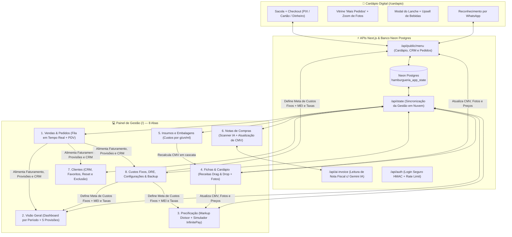

# 🍔 Monster Burger — Sistema Integrado de Gestão Financeira, Fichas Técnicas, PDV & Cardápio Digital Delivery

Sistema web completo desenvolvido sob medida para a operação da **Monster Burger (Burger Artesanal na Brasa)**, conectando em tempo real o **Cardápio Digital de Autoatendimento (estilo iFood)** à **Fila de Pedidos da Cozinha**, **Engenharia de Cardápio (Fichas Técnicas & CMV)**, **Precificação por Markup Divisor**, **Leitura de Notas Fiscais com IA**, **CRM de Clientes** e **DRE / Controle de Provisões com Teto Mensal Inteligente**.

🔗 **URL de Produção:** [https://monsterburger.vercel.app](https://monsterburger.vercel.app)  
📱 **Cardápio Público dos Clientes:** [https://monsterburger.vercel.app/cardapio](https://monsterburger.vercel.app/cardapio)

---

## 🗺️ Arquitetura e Como Tudo se Comunica

### 🔄 Ciclo de Comunicação Automática (O que conversa com o quê)
1. **Insumos (`Aba 5`) ➔ Fichas Técnicas (`Aba 4`) ➔ Precificação (`Aba 3`):**
   * Quando você altera o preço pago em um ingrediente (ou lança uma Nota Fiscal na `Aba 6`), o sistema recalcula instantaneamente o **custo por grama/unidade** daquele insumo, atualiza o **CMV (Custo de Mercadoria Vendida)** de todos os lanches que levam aquele item e recalcula o **Preço Sugerido**, o **Lucro Líquido** e a **Margem Real** na aba de Precificação.
2. **Fichas & Cardápio (`Aba 4`) + Custos Fixos (`Aba 8`) ➔ Cardápio do Cliente (`/cardapio`):**
   * Toda alteração de foto, nome comercial, descrição, preço praticado, destaque de *"Mais Pedido"*, chave PIX, WhatsApp da loja ou status *"Loja Aberta/Fechada"* é salva automaticamente na nuvem e reflete na mesma hora no link público `/cardapio`.
3. **Cardápio do Cliente (`/cardapio`) ➔ Fila de Pedidos (`Aba 1`) + Clientes (`Aba 7`):**
   * Quando o cliente finaliza um pedido no celular, o pedido entra imediatamente na **Fila de Pedidos em Tempo Real** da gestão (tocando um **alerta sonoro** na cozinha), cadastra ou atualiza o histórico e endereço do cliente na aba **Clientes** e gera a comanda formatada para o WhatsApp.
4. **Vendas (`Aba 1`) + Custos Fixos (`Aba 8`) ➔ Visão Geral (`Aba 2`):**
   * Cada venda realizada (pelo cardápio online ou pelo PDV rápido) é fatiada automaticamente nas **5 Caixinhas de Provisão**:
     1. **Reposição de Estoque (CMV)**
     2. **Taxa da Maquininha (InfinitePay)**
     3. **Taxas do Entregador (Diária do Motoboy)**
     4. **Despesas Fixas + Guia MEI (`R$ 599,90/mês`)**
     5. **Lucro Líquido do Período**
   * **Regra Inteligente de Excedente (Teto Mensal):** Assim que o volume de vendas do mês acumula os **R$ 599,90** necessários para quitar 100% das Despesas Fixas + MEI do mês, o sistema trava essa despesa como **100% Quitada** e converte a porcentagem de custo fixo de todas as vendas seguintes diretamente em **Sobra que entra como Lucro Líquido**.

---

## 📱 Parte 1: O Cardápio Digital do Cliente (`/cardapio`)

Projetado para máxima conversão no celular e computador, sem necessidade de baixar aplicativo:

### 1. Cabeçalho e Filtros Rápidos
* **Indicador de Status da Loja:** Mostra um selo verde (`Aberto agora`) ou vermelho (`Fechado no momento`) controlado lá na aba de Configurações da gestão, junto com o tempo médio de entrega (`35-50 min`) e avaliação (`4.9 ★`).
* **Botão `WhatsApp`:** Abre conversa direta com o número oficial da hamburgueria.
* **Barra de Busca (`Buscar lanche, ingrediente...`):** Filtra os produtos em tempo real pelo nome ou por qualquer ingrediente da descrição (ex: digitar *"bacon"* ou *"cheddar"*).
* **Abas de Categoria:** Botões horizontais (`Todos`, `Hambúrgueres`, `Porções & Combos`, `Bebidas`, `Sobremesas`) que filtram a lista com 1 toque.

### 2. Popup Inteligente de Reconhecimento ("Já pediu na Monster Burger?")
* Ao entrar no cardápio pela primeira vez, um modal convida o cliente a digitar seu WhatsApp:
  * **Se já for cliente cadastrado:** O sistema consulta o banco de dados (`GET /api/public/menu?phone=...`), dá boas-vindas pelo nome, **autopreenche todo o endereço de entrega** para o checkout e destaca os lanches favoritos dele.
  * **Se for a primeira vez:** Já deixa o WhatsApp preenchido na sacola para acelerar o fechamento do pedido.
  * **Botão `Pular por enquanto`:** Fecha o modal e libera a navegação imediata.

### 3. Vitrine "Os Mais Pedidos da Monster" (`★ Top Vendas`)
* Exibe em destaque no topo do cardápio os produtos marcados com a estrela **`Destacar como "Mais Pedido"`** na gestão.
* **Toque na Foto:** Abre o **Visualizador em Tela Cheia (Lightbox)** mostrando a foto do lanche inteira, sem cortes, com botão **`+ Escolher este item`**.
* **Toque no Card ou no botão `+ Pedir`:** Abre o Modal de Detalhes do Produto.

### 4. Lista "Cardápio Completo" e Interações de Cada Card
* Cada item mostra Nome, selo `Mais Pedido` (se aplicável), descrição dos ingredientes, preço e foto completa à direita (`object-contain`, sem cortar o lanche).
* **Clique na Foto do Lanche:** Abre o **Zoom em Tela Cheia (Lightbox)** para o cliente ver a foto grande inteira.
* **Clique no botão `+ Adicionar` (ou no corpo do card):** Abre o **Modal de Detalhes e Upsell**.
* **Botões `-` e `+` no Card:** Quando o item já está na sacola, o botão muda para um seletor rápido `- 1 +` para aumentar ou diminuir a quantidade direto na lista.

### 5. Modal de Detalhes do Produto + Upsell Automático de Bebidas
* **Foto Ampliada no Topo:** Exibe o lanche inteiro (clicável para tela cheia).
* **Bloco de Upsell ("Vai uma bebida gelada para acompanhar?"):** Quando o cliente escolhe um hambúrguer, o modal exibe automaticamente a lista de **Bebidas** cadastradas no cardápio com caixas de seleção (`checkbox`). Ao marcar uma bebida, o valor já soma no botão final!
* **Campo de Observações:** Espaço para o cliente digitar preferências (`Ex: Sem cebola, ponto bem passado, maionese à parte...`).
* **Seletor de Quantidade (`-` / `+`) e Botão `Adicionar à Sacola`:** Adiciona o lanche + bebidas escolhidas na sacola.

### 6. Barra Inferior (`Ver sacola e pedir`) & Gaveta de Checkout (`Sua Sacola`)
* **Controle de Itens na Sacola:** Botões `-` e `+` ao lado de cada item para ajustar quantidades ou remover da sacola.
* **Sugestão Inteligente na Sacola:** Se o cliente ainda não adicionou bebida, sugere bebidas com botão `+ Adicionar` de 1 toque; se já tem bebida, sugere outros itens do cardápio.
* **Dados de Entrega com Autopreenchimento:**
  * Ao digitar o **WhatsApp**, o sistema busca automaticamente o cadastro do cliente no banco e preenche **Nome**, **Rua**, **Número**, **Bairro**, **Complemento** e **Ponto de Referência**.
* **Seleção da Forma de Pagamento:**
  * **PIX:** Ao clicar em `Finalizar Pedido`, registra o pedido na fila da gestão e exibe na tela a **Chave PIX Oficial**, o botão **`Copiar Chave PIX`** e o botão verde **`Enviar Comanda e Comprovante no WhatsApp`**.
  * **Cartão de Crédito / Cartão de Débito (Na Entrega):** Ao clicar em `Finalizar Pedido`, registra o pedido na fila da gestão e **abre automaticamente o WhatsApp** com a comanda completa formatada para envio imediato.
  * **Dinheiro:** Exibe o campo **"Precisa de troco para quanto?"**, registra na fila da gestão e abre o WhatsApp com a comanda e a informação do troco.

---

## 💻 Parte 2: O Painel de Gestão (`/`) — Todas as 8 Abas e Botões

O acesso ao painel principal é protegido por senha/PIN (`Tela de Login`), com sessão criptografada e barra superior contendo:
* **Indicador de Nuvem (`Salvo na nuvem` / `Salvando...`):** Mostra que toda alteração feita em qualquer aba foi gravada automaticamente no banco de dados Postgres.
* **Botão `Importar Planilha (.xlsx)`:** Permite carregar dados a partir de planilha Excel.
* **Botão `Cardápio Digital`:** Abre a página `/cardapio` em uma nova aba.
* **Botão `Sair`:** Encerra a sessão administrativa com segurança.

---

### 🔔 Aba 1: `Vendas & Pedidos` (`SalesTab`)
Aba desenhada para ficar aberta durante o expediente de vendas:

1. **Fila de Pedidos em Tempo Real (Topo):**
   * Exibe **apenas os pedidos ativos** (`Recebido`, `Em Preparo` e `Saiu p/ Entrega`).
   * **Sincronização a cada 10s + Alerta Sonoro:** Verifica automaticamente novos pedidos vindos do site e toca um sinal sonoro quando chega pedido novo.
   * **Botões dentro de cada Comanda da Fila:**
     * `Recebido` ➔ `Em Preparo` ➔ `Saiu p/ Entrega`: Atualiza o estágio do pedido em tempo real.
     * **`Entregue`:** Assim que você clica em **`Entregue`**, o pedido **sai imediatamente da fila ativa** (para não poluir a tela da cozinha) e fica salvo no **Histórico de Pedidos**.
     * **`Cancelar`:** Cancela o pedido (pedidos cancelados não entram na soma de faturamento nem de custos).
     * **`Imprimir Comanda` (Ícone de Impressora):** Abre a janela de impressão térmica (formato 80mm) com itens, observações, endereço, pagamento e troco.
     * **`WhatsApp`:** Abre o WhatsApp do cliente já com uma mensagem pronta avisando o status atual do pedido (ex: *"Seu pedido #105 já está em preparo na brasa!"* ou *"Saiu para entrega!"*).

2. **PDV — Lançamento de Venda Rápida (Balcão / WhatsApp):**
   * Permite lançar manualmente pedidos recebidos fora do site:
   * **Campo `WhatsApp`:** Ao digitar o telefone de um cliente já conhecido, puxa Nome e Endereço automaticamente.
   * **Grade de Produtos Rápidos:** Clique nos produtos para adicioná-los ao pedido manual.
   * **Botão `Registrar Pedido`:** Cria o pedido com status inicial **`Em Preparo`** (entrando direto na Fila em Tempo Real), salva o cliente no CRM e contabiliza a venda no financeiro.

3. **Histórico de Pedidos com Filtro de Data:**
   * **Seletor de Período:** Filtre os pedidos por `Hoje`, `Ontem`, `Últimos 7 dias`, `Últimos 30 dias`, `Este Mês`, `Período Personalizado (De / Até)` ou `Todo o Histórico`.
   * **Filtro de Status e Busca:** Filtre entre `Todos`, `Entregues`, `Ativos na Fila` ou `Cancelados`, ou busque pelo nome/telefone/`#número`.
   * **Botão Lixeira (`Excluir`):** Remove permanentemente um pedido de teste ou lançado por engano.

---

### 📊 Aba 2: `Visão Geral` (`OverviewTab`)
O centro de inteligência financeira do negócio, 100% conectado ao período de datas escolhido:

1. **Seletor de Período no Topo:**
   * Escolha ver os números de `Hoje`, `Ontem`, `Últimos 7 dias`, `Últimos 30 dias`, `Este Mês`, `Personalizado` ou `Tudo`.
2. **Botões de Ação Rápida:**
   * `Lançar Nota Fiscal` (leva direto para a aba de Notas) e `Registrar Venda` (leva para o PDV).
3. **4 Cartões Principais (KPIs):**
   * **Receita de Vendas:** Faturamento bruto do período + quantidade de pedidos e ticket médio.
   * **Lucro Líquido (Vendas):** Dinheiro limpo gerado pelas vendas do período (já somando a sobra de custos fixos caso as contas do mês já estejam quitadas).
   * **Taxas do Entregador (Período):** Valor exato acumulado pelas vendas do período para pagar o motoboy + margem média do cardápio.
   * **Quitação de Custos Fixos:** Mostra quanto as vendas do mês já juntaram para pagar a meta mensal de **R$ 599,90** (`R$ 519,90` de Contas + `R$ 80,00` do MEI) e informa se já está **`100% Quitado (Sobra = Lucro)`** ou quanto ainda falta.
4. **Painéis de Vendas do Período:**
   * **Itens Mais Vendidos:** Ranking das quantidades e valores vendidos de cada produto no período.
   * **Formas de Pagamento:** Quantos pedidos e quanto dinheiro entrou via PIX, Cartão de Crédito, Débito ou Dinheiro.
5. **Gráfico "Estrutura de Preço, CMV e Lucro por Produto":**
   * Barras visuais comparando o peso do **CMV (vermelho)**, **Fixos + Taxas (cinza)** e **Lucro Líquido (verde)** em cada item do cardápio.
6. **Painel "Provisões sobre as Vendas do Período" (As 5 Caixinhas):**
   * Mostra exatamente quanto separar do faturamento do período selecionado para:
     1. **Reposição de Estoque (CMV)**
     2. **Taxa Cartão (InfinitePay)** (descontada apenas sobre vendas reais no cartão)
     3. **Taxas do Entregador** (`6%` reservados nos lanches + taxas de entrega cobradas)
     4. **Despesas Fixas + MEI** (`11,01%` até atingir o teto mensal de `R$ 599,90`; atingido o teto, exibe o badge verde **`↳ Sobra de Fixos + MEI (Quitado → Lucro)`**)
     5. **Lucro Líquido do Período**

---

### 🏷️ Aba 3: `Precificação` (`PricingTab`)
Onde você define os preços e protege suas margens usando o método financeiro do **Markup Divisor**:

1. **Tabela de Precificação por Produto:**
   * **Fórmula utilizada:** `Preço Sugerido = CMV ÷ [1 - (Fixos + MEI% + Cartão Créd.% + Taxa Entrega% + Margem Alvo%)]`.
   * **Colunas Editáveis por Produto:**
     * **`Fixos + MEI (%)`:** Percentual reservado para pagar as Despesas Fixas Mensais + Guia MEI (calibrado em **`11,01%`** para quitar `R$ 599,90/mês` em 8 dias de funcionamento vendendo 30 lanches/dia).
     * **`Cartão Créd. (%)`:** Percentual da taxa da maquininha InfinitePay no cartão de crédito (**`3,00%`**), garantindo que o preço do lanche já proteja sua margem mesmo quando o cliente paga no crédito.
     * **`Taxa Entrega (%)`:** Percentual reservado em cada lanche para formar a diária do entregador (**`6,00%`**, gerando ~`R$ 40,86/dia` em 30 lanches).
     * **`Meta (%)`:** Margem de lucro líquida alvo desejada.
     * **`Praticado (R$)`:** Preço final de venda no cardápio (ao alterar aqui, atualiza automaticamente no Cardápio Online).
   * **Colunas Calculadas Automaticamente:** `CMV`, `Preço Sugerido`, `Lucro Líquido (R$)` e `Margem Real (%)`.

2. **Simulador por Meio de Recebimento (Painel Inferior):**
   * Clique em qualquer produto da tabela e alterne entre os 3 botões:
     * **`Cartão Crédito InfinitePay (3,00%)`:** Mostra o lucro líquido descontando a taxa de crédito da tabela.
     * **`Cartão Débito InfinitePay (1,37%)`:** Substitui a taxa de crédito pela de débito e mostra o ganho extra de margem.
     * **`PIX / Dinheiro (0% Maquininha)`:** Zera a taxa de maquininha e mostra os `3%` entrando diretamente como lucro líquido extra no seu bolso.

---

### 📋 Aba 4: `Fichas & Cardápio` (`RecipesTab`)
Engenharia de cardápio completa conectada ao estoque de insumos e à vitrine do site:

1. **Barra de Produtos e Criação:**
   * Selecione qualquer produto nas abas superiores ou clique em **`+ Novo Produto`** para cadastrar um novo lanche, porção, bebida ou sobremesa.
2. **Controles do Produto Selecionado:**
   * **Checkbox `Visível no Cardápio Online`:** Ativa ou oculta o produto imediatamente no site dos clientes.
   * **Checkbox `★ Destacar como "Mais Pedido"`:** Coloca o produto na vitrine de topo *"Os Mais Pedidos da Monster"* no cardápio digital.
   * **Botão `+ Kit Embalagem`:** Adiciona com 1 clique `Papel Acoplado`, `Saco Kraft` e qualquer item de `Potinho / Maionese da Casa` na seção de embalagens do lanche.
   * **Botão `Duplicar`:** Cria uma cópia completa da ficha técnica atual para facilitar o cadastro de um lanche parecido.
   * **Botão `Excluir` (Lixeira):** Remove o produto do sistema.
3. **Formulário `Adicionar Insumo`:**
   * Escolha o insumo, defina a **`Seção na Ficha`** (`Automático`, `Alimentos (Receita)` ou `Embalagens & Fixos`), informe a quantidade em gramas/unidades e clique em **`+ Adicionar Insumo`**.
4. **Tabelas de `Alimentos` e de `Embalagens & Itens Fixos` com Ordenação Arrastável (Drag-and-Drop):**
   * **Arrastar e Soltar (`⋮⋮`):** Segure qualquer linha pelo ícone lateral e arraste para cima ou para baixo (ou use as setas `↑` / `↓`) para organizar a sequência exata de montagem do lanche.
   * **Edição de Quantidade (`Qtd`):** Altere as gramas ou unidades de qualquer ingrediente e veja o subtotal e o CMV atualizarem na hora.
   * **Botão `Aplicar em Todos os Lanches` (na tabela de Embalagens):** Copia com 1 clique a configuração de embalagens e acompanhamentos fixos (ex: Papel Acoplado + Saco Kraft + Potinho de Maionese da Casa) do lanche atual para todos os hambúrgueres do cardápio.
5. **Painel Direito — `Foto e Dados no Cardápio` & `Resumo de Custos`:**
   * **Botão `Trocar Foto` / `Enviar Foto do Lanche`:** Faz upload da foto do produto mantendo a proporção inteira sem cortar o lanche.
   * **Campos `Nome Comercial`, `Categoria no Cardápio`, `Descrição dos Ingredientes` e `Preço Praticado`:** Tudo o que é digitado aqui aparece em tempo real no Cardápio Digital dos clientes.

---

### 📦 Aba 5: `Insumos` (`IngredientsTab`)
A base de preços de todas as matérias-primas, molhos, bebidas e embalagens:

1. **Formulário de Cadastro Rápido (Topo):**
   * Cadastre qualquer item informando `Nome do Insumo`, `Categoria`, `Embalagem Compra` (ex: *Pacote 1kg*, *Fardo 12 un*), `Preço Pago (R$)`, `Conteúdo` (ex: `1000`) e `Unidade` (`g`, `un`, `ml`, `l`). O sistema calcula sozinho o **Custo Unitário** (ex: `R$ 0,0340 / g`).
2. **Filtros por Categoria e Busca Rápida:**
   * Filtre por `Proteína`, `Panificação`, `Queijos e Frios`, `Molhos`, `Hortifrúti e Conservas`, `Acompanhamentos`, `Bebidas`, `Embalagem`, `Óleos e Gorduras` ou digite na busca.
3. **Tabela de Insumos com Colunas Clicáveis para Ordenação:**
   * **Clique no título de qualquer coluna** (`Categoria`, `Item / Insumo`, `Embalagem`, `Preço Pago`, `Conteúdo`, `Unid.` ou `Custo Unitário`) para organizar a lista em ordem crescente (`↑`) ou decrescente (`↓`) — por exemplo, ordem alfabética `A–Z` ou do insumo mais caro para o mais barato.
   * **Edição Direta na Linha:** Ao mudar a categoria, embalagem, preço pago ou conteúdo diretamente na tabela, **todas as fichas técnicas do sistema são recalculadas na mesma hora**.
   * **Botão de Histórico (`Ícone de Relógio`):** Abre um modal com todo o histórico de variações de preço e fornecedores daquele insumo.

---

### 🧾 Aba 6: `Notas (Compras)` (`InvoicesTab`)
Controle de compras de estoque e atualização automatizada de custos via Inteligência Artificial:

1. **Leitor de Nota Fiscal / Cupom com IA (`Gemini Vision`):**
   * Clique para enviar a foto ou arquivo da nota/cupom de compra do mercado ou distribuidor.
   * A Inteligência Artificial lê a imagem, extrai o nome do estabelecimento, data, número da nota e lista todos os produtos comprados com seus preços e quantidades.
   * Você vincula cada item da nota ao insumo correspondente do seu estoque e, ao confirmar, o sistema **atualiza automaticamente o preço pago e o histórico de preços dos insumos**, recalculando o CMV dos lanches!
2. **Lançamento Manual de Nota Fiscal e Histórico de Compras:**
   * Permite registrar compras manualmente por categoria (`Insumos Alimentícios`, `Embalagens`, `Bebidas`, `Gás e Energia`, `Equipamentos e Utensílios`, `Limpeza e Outros`) para alimentar os gráficos de compras na Visão Geral.

---

### 👥 Aba 7: `Clientes` (`CustomersTab`)
Banco de dados (CRM) construído automaticamente a cada pedido:

1. **Indicadores e Busca:**
   * Mostra o total de clientes cadastrados, clientes recorrentes (fidelizados) e faturamento total identificado, com barra de busca por nome, telefone ou rua/bairro.
2. **Ficha Completa de Cada Cliente:**
   * Exibe Nome, WhatsApp formatado, Endereço completo salvo, data do último pedido, quantidade total de pedidos, valor total gasto (`LTV`), ticket médio e as **tags dos produtos que ele mais pede (`Favoritos`)**.
3. **Botões de Ação por Cliente:**
   * **`WhatsApp`:** Abre conversa direta com o cliente.
   * **`Resetar Cliente` (Ícone de Setas Circulares):** Zera a contagem de pedidos, total gasto e histórico financeiro daquele cliente (ideal após fazer pedidos de teste), **mantendo o nome, telefone e endereço salvos** para ele não precisar digitar tudo de novo.
   * **`Excluir Cliente` (Ícone de Lixeira):** Apaga o perfil do cliente do banco de dados.
   * **`Limpar Todos os Clientes` (Topo):** Botão de limpeza geral para zerar a base de testes quando necessário.

---

### 💰 Aba 8: `Custos Fixos` (`FinanceDreTab`)
Planejamento financeiro mensal, configurações gerais da loja, segurança e backups:

1. **Termômetro de Quitação das Despesas Fixas + MEI (`R$ 599,90/mês`):**
   * Mostra quantos lanches vendidos no mês são necessários para pagar 100% das contas fixas + MEI (`240 lanches/mês` = `30 lanches/dia` em `8 dias`), quanto já foi acumulado pelas vendas reais do mês e quanto falta para que toda a taxa de custo fixo dos próximos lanches vire **Lucro Líquido extra**.
2. **Simulador de Operação (`8 Dias no Mês Sáb/Dom • 30 Lanches/Dia`):**
   * Permite simular qualquer meta de lanches por dia e quantidade de dias trabalhados no mês, mostrando lado a lado o valor diário e mensal das 5 caixinhas:
     1. `Faturamento` (`R$ 681,00/dia` | `R$ 5.448,00/mês`)
     2. `Reposição Estoque (CMV)` (`R$ 237,16/dia` | `R$ 1.897,28/mês`)
     3. `Diária do Entregador` (`R$ 40,86/dia` | `R$ 326,88/mês`)
     4. `Despesas Fixas + MEI` (`R$ 74,99/dia` | `R$ 599,90/mês`)
     5. `Lucro Líquido Limpo` (já descontando a reserva de cartão da precificação).
3. **Gestão de Despesas Fixas Mensais + MEI:**
   * Adicione novas contas fixas (`Utilidades`, `Logística / Gasolina`, `Impostos Fixos (MEI)`, `Sistemas / Telefonia`, `Outros`), edite o valor mensal de cada conta em tempo real, marque como **`Pago`** ou **`Pendente`** no mês, ou exclua contas.
4. **Configurações do Cardápio Online & Taxas da Maquininha:**
   * **Chave Liga/Desliga `Loja Aberta para Pedidos`:** Abre ou fecha o recebimento de pedidos no `/cardapio`.
   * **Dados do Delivery & PIX:** Edite o `WhatsApp Oficial de Recebimento`, `Chave PIX Oficial`, `Nome do Favorecido PIX`, `Tempo Médio de Entrega` e `Taxa de Entrega Padrão (R$)`.
   * **Taxas da Maquininha InfinitePay:** Configure as taxas reais de `PIX (%)`, `Cartão de Débito (%)` e `Cartão de Crédito (%)`.
5. **Segurança & Backup de Dados:**
   * **Alterar Senha / PIN da Gestão:** Troque a senha de acesso ao painel administrativo a qualquer momento (criptografada com `SHA-256`).
   * **`Exportar Backup (.json)` & `Restaurar Backup`:** Baixe uma cópia completa de segurança de todos os seus dados (insumos, fichas, fotos, clientes, pedidos e configurações) ou restaure a partir de um arquivo `.json`.

---

## 🛠️ Tecnologias Utilizadas

* **Frontend & Fullstack Framework:** Next.js 15 (App Router) + React 19 + TypeScript
* **Estilização:** Tailwind CSS + Lucide Icons (Design System Dark Mode de alto contraste)
* **Banco de Dados em Nuvem:** Neon Serverless Postgres (`@neondatabase/serverless`) com persistência JSONB transacional e fallback local automático
* **Inteligência Artificial:** Google Gemini Vision API (`/api/ai-invoice`) para OCR e extração estruturada de notas fiscais de compra
* **Segurança:** Autenticação HTTP-Only com assinatura `HMAC-SHA256`, hash de senha customizado no banco e Rate Limiting contra força bruta
* **Hospedagem & CI/CD:** Vercel Production (`https://monsterburger.vercel.app`)
